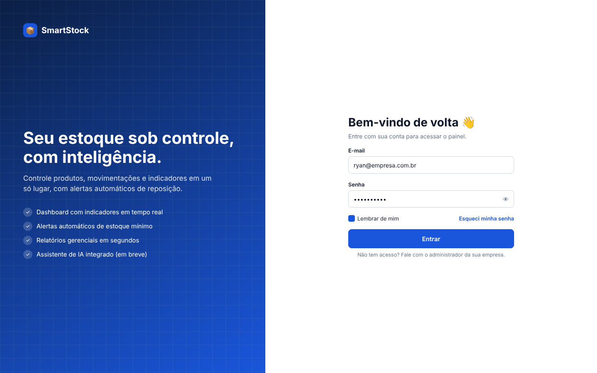
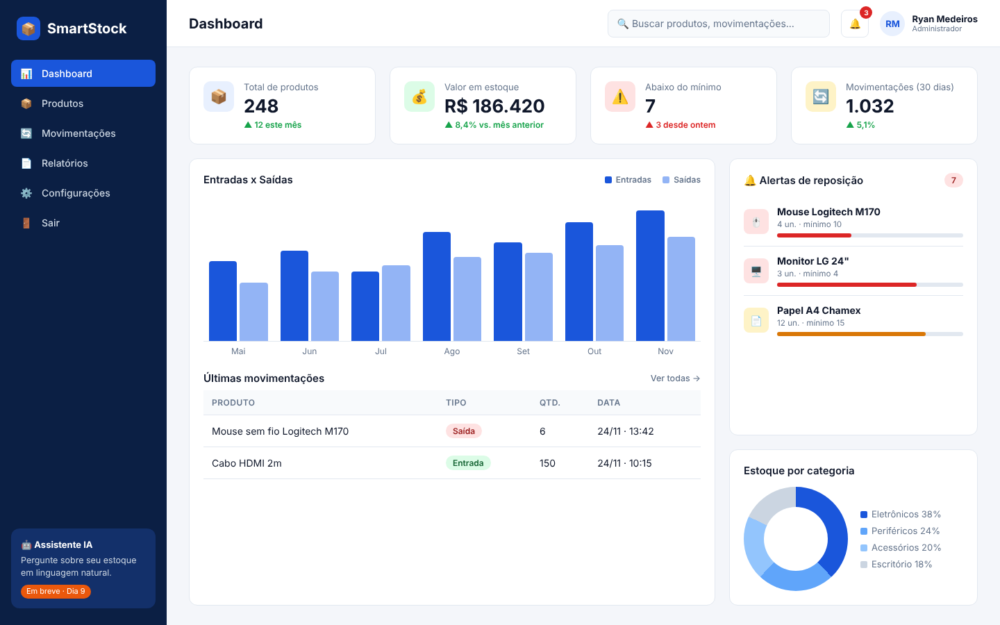
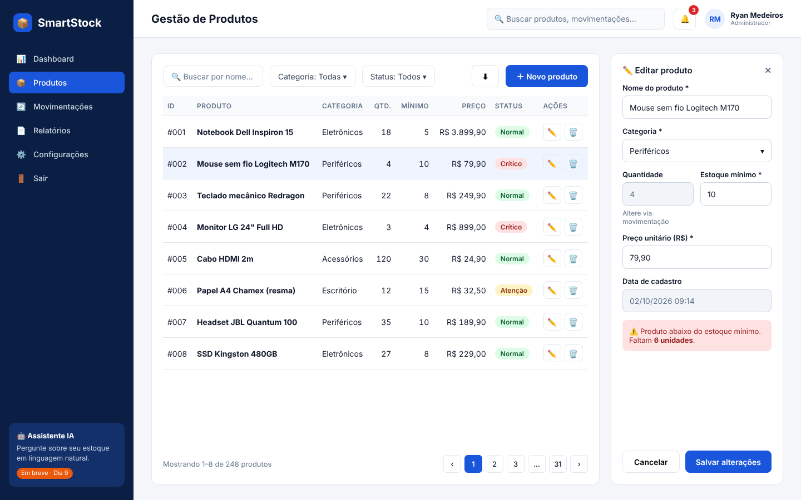
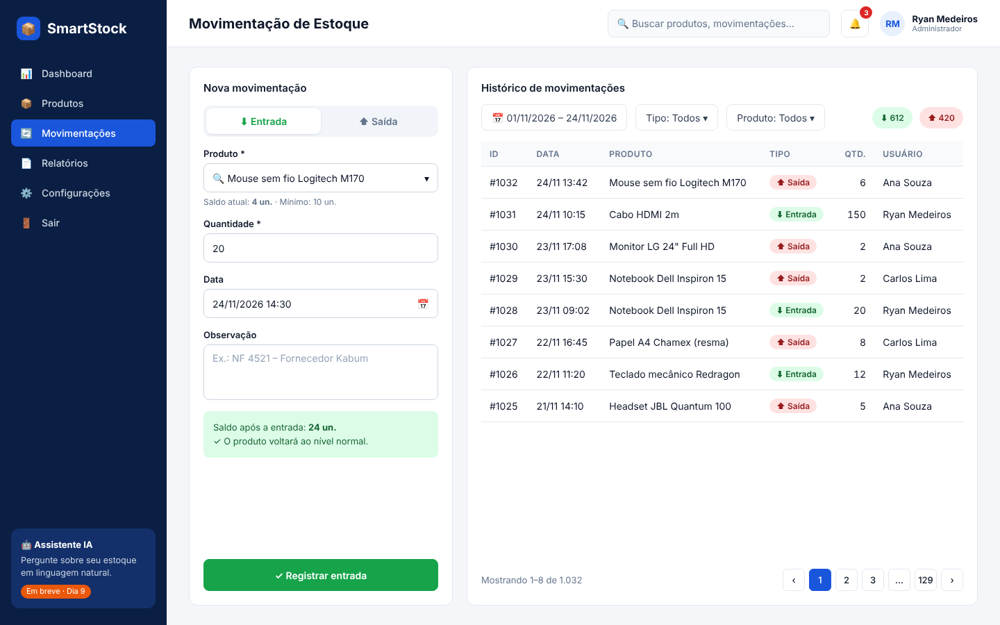
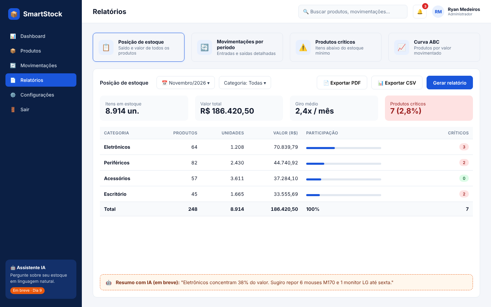
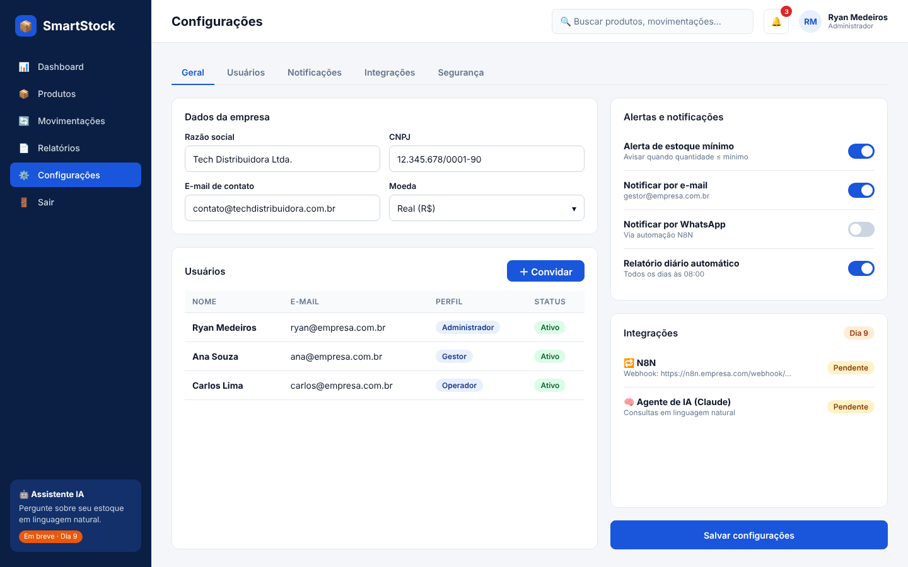
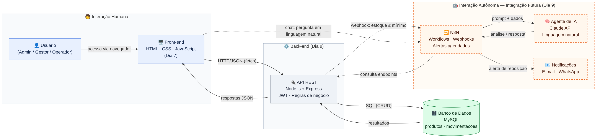
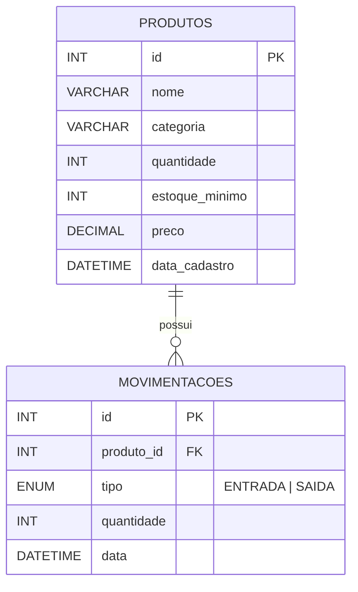

# 📦 SmartStock — Plataforma Inteligente de Gestão de Estoque

> Projeto Integrador do **Programa de Estágio de Férias – Desenvolvimento de Software (DEV)**
> **Atividade 6 (Dia 6): Planejamento, Design e Arquitetura da Solução**
> Autor: **Ryan Medeiros**

Plataforma web para empresas controlarem produtos, entradas e saídas de estoque, níveis mínimos, relatórios e indicadores, com integração futura com **Inteligência Artificial** e **N8N**.

---

## ✅ Entregáveis da Atividade 6

| Entregável | Onde está |
|---|---|
| 📄 Documento de requisitos | [`docs/01-requisitos.md`](docs/01-requisitos.md) |
| 🗄️ Modelo do banco de dados (DER + SQL) | [`docs/02-banco-de-dados.md`](docs/02-banco-de-dados.md) · [`database/schema.sql`](database/schema.sql) · [`diagramas/der.png`](diagramas/der.png) |
| 🏗️ Fluxograma da arquitetura | [`docs/03-arquitetura.md`](docs/03-arquitetura.md) · [`diagramas/arquitetura.png`](diagramas/arquitetura.png) |
| 🎨 Link do protótipo no Figma | **https://www.figma.com/design/iBujYsVVPs2T4p35vuAzIg** · detalhes em [`docs/04-prototipo.md`](docs/04-prototipo.md) |
| 🖼️ Capturas de tela do protótipo | [`prototipo/capturas/`](prototipo/capturas) |
| 🐙 Repositório GitHub com toda a documentação | este repositório |

## 🖼️ Prévia

| Login | Dashboard |
|---|---|
|  |  |
| **Gestão de Produtos** | **Movimentação de Estoque** |
|  |  |
| **Relatórios** | **Configurações** |
|  |  |

## 🏗️ Arquitetura (resumo)



`Usuário → Front-end (HTML/CSS/JS) → API REST (Node.js/Express) → MySQL`
Integração futura: `API ⇄ N8N ⇄ Agente de IA (Claude API)` para alertas automáticos e consultas em linguagem natural.

## 🗄️ Banco de dados (resumo)



## ⚙️ Funcionalidades mínimas

- [x] Cadastro, consulta, atualização e exclusão de produtos
- [x] Controle de entrada e saída de estoque
- [x] Dashboard com indicadores
- [x] Relatórios de estoque
- [x] Controle de estoque mínimo e alertas de reposição
- [x] Integração futura com IA (planejada)

*(Dia 6 = planejamento e design; a implementação acontece nos Dias 7, 8 e 9.)*

## 🗺️ Roadmap

| Dia | Etapa | Status |
|---|---|---|
| 6 | Planejamento e Design (fundações) | ✅ Concluído |
| 7 | Desenvolvimento Front-end (interface) | ⏳ |
| 8 | Back-end e Banco de Dados (motor) | ⏳ |
| 9 | Integração com IA, N8N e finalização | ⏳ |

## 📁 Estrutura do repositório

```
smartstock/
├── README.md
├── docs/
│   ├── 01-requisitos.md        # objetivo, problema, público, RF/RNF, regras, casos de uso, benefícios
│   ├── 02-banco-de-dados.md    # DER, dicionário de dados, relacionamentos
│   ├── 03-arquitetura.md       # fluxograma, camadas, pontos de integração IA/N8N, endpoints
│   └── 04-prototipo.md         # link do Figma, telas, guia de estilo, UX/UI
├── database/
│   └── schema.sql              # script MySQL (tabelas, índices, view, dados de exemplo)
├── diagramas/
│   ├── arquitetura.mmd/.png/.svg
│   └── der.mmd/.png/.svg
└── prototipo/
    ├── index.html              # protótipo navegável em HTML
    └── capturas/               # prints das 6 telas
```

## 🛠️ Tecnologias planejadas

HTML5 · CSS3 · JavaScript · Node.js · Express · MySQL · JWT · N8N · Claude API · Figma · Git/GitHub
