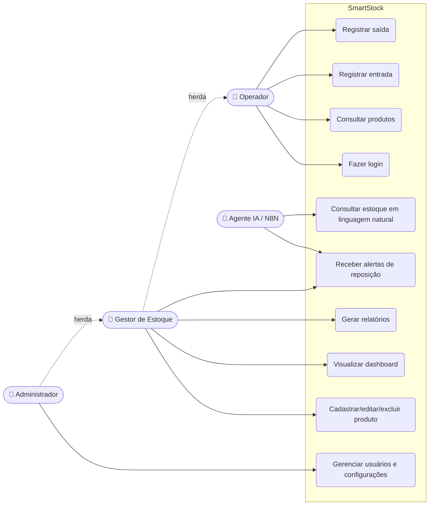

# 📄 Documento de Requisitos — SmartStock

**Projeto:** SmartStock – Plataforma Inteligente de Gestão de Estoque
**Programa:** Estágio de Férias – Desenvolvimento de Software (DEV) · Atividade 6 (Dia 6)
**Autor:** Ryan Medeiros
**Versão:** 1.0 · **Data:** 24/11/2026

---

## 1. Objetivo do sistema

Desenvolver uma plataforma web que centralize o controle de estoque de pequenas e médias empresas, permitindo cadastrar produtos, registrar entradas e saídas, acompanhar níveis mínimos, gerar relatórios gerenciais e visualizar indicadores em um dashboard. A plataforma será preparada para integração com **Inteligência Artificial** e **N8N**, possibilitando consultas em linguagem natural, alertas automáticos e apoio à tomada de decisão.

## 2. Problema que será resolvido

Muitas empresas ainda controlam estoque em planilhas, cadernos ou sistemas desconectados, o que gera:

| Problema | Consequência |
|---|---|
| Falta de controle dos produtos | Divergência entre o estoque físico e o registrado |
| Perdas por falta de reposição | Ruptura de estoque, vendas perdidas, cliente insatisfeito |
| Informações descentralizadas | Cada setor tem "sua versão" dos números |
| Dificuldade na geração de relatórios | Horas gastas montando relatórios manualmente |
| Processos manuais sujeitos a falhas | Erros de digitação, lançamentos esquecidos ou duplicados |

## 3. Público-alvo

- **Pequenas e médias empresas** do comércio varejista, atacado, distribuidoras, e-commerces e pequenas indústrias.
- **Perfis de usuário:**

| Perfil | Descrição | Permissões |
|---|---|---|
| **Administrador** | Dono/gestor da empresa | Acesso total, incluindo usuários e configurações |
| **Gestor de estoque** | Responsável pelo almoxarifado | Produtos, movimentações, relatórios e alertas |
| **Operador** | Funcionário do estoque | Consulta de produtos e registro de entradas/saídas |

## 4. Funcionalidades do sistema

### 4.1 Requisitos Funcionais (RF)

| ID | Requisito | Prioridade |
|---|---|---|
| RF01 | Autenticar usuário com e-mail e senha (login/logout) | Alta |
| RF02 | Cadastrar produtos (nome, categoria, quantidade, estoque mínimo, preço) | Alta |
| RF03 | Consultar produtos com busca por nome e filtro por categoria/status | Alta |
| RF04 | Atualizar dados de um produto | Alta |
| RF05 | Excluir produto (com confirmação) | Alta |
| RF06 | Registrar **entrada** de estoque, somando à quantidade do produto | Alta |
| RF07 | Registrar **saída** de estoque, subtraindo da quantidade (bloquear se saldo insuficiente) | Alta |
| RF08 | Exibir histórico de movimentações com filtros por período, produto e tipo | Alta |
| RF09 | Exibir dashboard com indicadores: total de produtos, valor em estoque, itens abaixo do mínimo, movimentações do período | Alta |
| RF10 | Definir estoque mínimo por produto e sinalizar itens abaixo dele | Alta |
| RF11 | Gerar alertas de reposição quando a quantidade ficar ≤ estoque mínimo | Alta |
| RF12 | Gerar relatórios de estoque (posição atual, movimentações por período, produtos críticos) | Média |
| RF13 | Exportar relatórios em PDF e CSV | Média |
| RF14 | Configurar dados da empresa, usuários e preferências de notificação | Média |
| RF15 | Disponibilizar endpoints/webhooks para integração com N8N e agente de IA | Média (Dia 9) |
| RF16 | Permitir consultas em linguagem natural ao estoque via agente de IA | Baixa (Dia 9) |

### 4.2 Requisitos Não Funcionais (RNF)

| ID | Requisito |
|---|---|
| RNF01 | **Usabilidade:** interface responsiva (desktop, tablet e celular), seguindo boas práticas de UX/UI e acessibilidade (contraste AA, rótulos em formulários) |
| RNF02 | **Desempenho:** consultas e listagens devem responder em até 2 segundos para até 10.000 produtos |
| RNF03 | **Segurança:** senhas armazenadas com hash (bcrypt), autenticação via token JWT, comunicação via HTTPS |
| RNF04 | **Integridade:** movimentações gravadas em transação junto com a atualização da quantidade do produto |
| RNF05 | **Arquitetura:** separação em camadas (Front-end, API REST, Banco de Dados) |
| RNF06 | **Persistência:** banco de dados relacional (MySQL) |
| RNF07 | **Disponibilidade:** acesso via navegador moderno, sem instalação |
| RNF08 | **Manutenibilidade:** código versionado no GitHub e documentado |
| RNF09 | **Auditoria:** toda movimentação registra data/hora e usuário responsável |
| RNF10 | **Integração:** API documentada (JSON) para consumo pelo N8N e pelo agente de IA |

### 4.3 Regras de Negócio (RN)

| ID | Regra |
|---|---|
| RN01 | A quantidade de um produto nunca pode ficar negativa |
| RN02 | Toda alteração de quantidade deve ocorrer via movimentação (entrada/saída), nunca por edição direta |
| RN03 | Um produto está **crítico** quando `quantidade <= estoque_minimo` |
| RN04 | Produto que já possui movimentações não pode ser excluído, para preservar o histórico (garantido no banco pela FK com `ON DELETE RESTRICT`) |
| RN05 | Quantidade de movimentação deve ser maior que zero |

### 4.4 Casos de Uso

| Caso de uso | Ator | Fluxo principal |
|---|---|---|
| **UC3 – Registrar entrada** | Operador | 1. Acessa *Movimentações* → 2. Seleciona tipo **Entrada** → 3. Escolhe o produto → 4. Informa quantidade e observação → 5. Confirma → 6. Sistema grava a movimentação e soma a quantidade |
| **UC4 – Registrar saída** | Operador | Igual ao UC3 com tipo **Saída**. **Exceção:** se a quantidade for maior que o saldo, o sistema exibe erro e não grava. Se o saldo ficar ≤ mínimo, dispara alerta (UC8) |
| **UC5 – Cadastrar produto** | Gestor | 1. Acessa *Produtos* → 2. Clica em "Novo produto" → 3. Preenche os campos → 4. Salva → 5. Sistema valida campos obrigatórios e grava com a data de cadastro |
| **UC8 – Alerta de reposição** | Sistema / N8N | 1. Após uma saída, a API verifica `quantidade <= estoque_minimo` → 2. Envia webhook ao N8N → 3. N8N notifica o gestor (e-mail/WhatsApp) e registra o alerta |
| **UC10 – Consulta em linguagem natural** | Gestor / IA | 1. Usuário pergunta "Quais produtos vão acabar esta semana?" → 2. N8N envia ao agente de IA (Claude API) → 3. IA consulta a API → 4. Resposta é exibida ao usuário |

## 5. Benefícios da solução

- **Centralização dos dados:** uma única fonte confiável para todo o estoque.
- **Redução de perdas:** alertas automáticos evitam ruptura e compras de última hora.
- **Agilidade:** relatórios prontos em segundos em vez de horas em planilhas.
- **Menos erros:** saldo calculado automaticamente a partir das movimentações.
- **Decisão baseada em dados:** dashboard com indicadores em tempo real.
- **Rastreabilidade:** histórico completo de quem moveu o quê e quando.
- **Escalabilidade e inovação:** arquitetura preparada para IA e automações (N8N).

## 6. Escopo por etapa

| Dia | Entrega |
|---|---|
| **6** | Planejamento: requisitos, banco de dados, arquitetura, protótipo (este documento) |
| 7 | Front-end das 6 telas prototipadas |
| 8 | Back-end (API REST) e banco de dados MySQL |
| 9 | Integração com IA e N8N, alertas automáticos e finalização |
