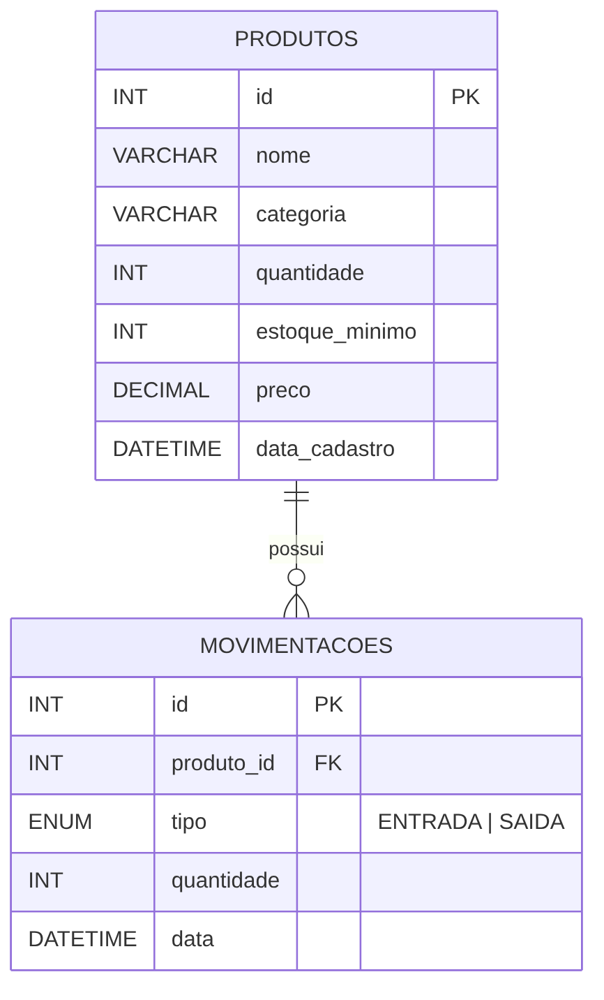
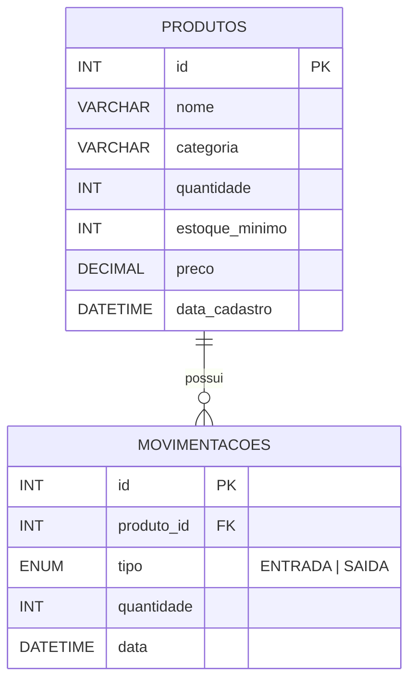

# 🗄️ Modelagem do Banco de Dados — SmartStock

SGBD: **MySQL 8** · Script completo: [`database/schema.sql`](../database/schema.sql)

## 1. DER (Diagrama Entidade-Relacionamento)





## 2. Relacionamento

- **Produtos (1) ──< (N) Movimentações**
- Um produto pode ter **zero ou muitas** movimentações.
- Cada movimentação pertence a **exatamente um** produto (`produto_id` → `produtos.id`).
- `ON DELETE RESTRICT`: um produto com histórico não pode ser excluído (RN04).

## 3. Dicionário de dados

### Tabela `produtos`

| Campo | Tipo | Nulo | Padrão | Descrição |
|---|---|---|---|---|
| `id` | INT UNSIGNED **PK** AI | Não | — | Identificador do produto |
| `nome` | VARCHAR(120) | Não | — | Nome do produto |
| `categoria` | VARCHAR(60) | Não | — | Categoria (Eletrônicos, Periféricos...) |
| `quantidade` | INT UNSIGNED | Não | 0 | Saldo atual em estoque |
| `estoque_minimo` | INT UNSIGNED | Não | 0 | Quantidade mínima antes do alerta de reposição |
| `preco` | DECIMAL(10,2) | Não | 0.00 | Preço unitário (R$) |
| `data_cadastro` | DATETIME | Não | CURRENT_TIMESTAMP | Data/hora do cadastro |

### Tabela `movimentacoes`

| Campo | Tipo | Nulo | Padrão | Descrição |
|---|---|---|---|---|
| `id` | INT UNSIGNED **PK** AI | Não | — | Identificador da movimentação |
| `produto_id` | INT UNSIGNED **FK** | Não | — | Produto movimentado |
| `tipo` | ENUM('ENTRADA','SAIDA') | Não | — | Tipo da movimentação |
| `quantidade` | INT UNSIGNED | Não | — | Quantidade movimentada (> 0) |
| `data` | DATETIME | Não | CURRENT_TIMESTAMP | Data/hora da movimentação |

## 4. Objetos de apoio

- **Índices:** `produtos(nome)`, `produtos(categoria)`, `movimentacoes(produto_id, data)` → buscas e relatórios por período mais rápidos.
- **View `vw_produtos_criticos`:** lista produtos com `quantidade <= estoque_minimo`; será consumida pelo dashboard, pela tela de relatórios e pelo workflow de alertas no N8N.

## 5. Regra de atualização do saldo (implementação no Dia 8)

Toda movimentação é gravada **dentro de uma transação** junto com a atualização do saldo:

```sql
START TRANSACTION;
  INSERT INTO movimentacoes (produto_id, tipo, quantidade) VALUES (2, 'SAIDA', 3);
  UPDATE produtos SET quantidade = quantidade - 3
   WHERE id = 2 AND quantidade >= 3;   -- RN01: nunca negativo
  -- se nenhuma linha foi afetada → ROLLBACK (saldo insuficiente)
COMMIT;
```

## 6. Evoluções previstas (fora do mínimo exigido)

| Tabela | Finalidade |
|---|---|
| `usuarios` | Login, perfis (admin/gestor/operador) e auditoria (`usuario_id` em movimentações) |
| `categorias` | Normalizar a categoria em tabela própria |
| `alertas` | Histórico de alertas enviados pelo N8N |
