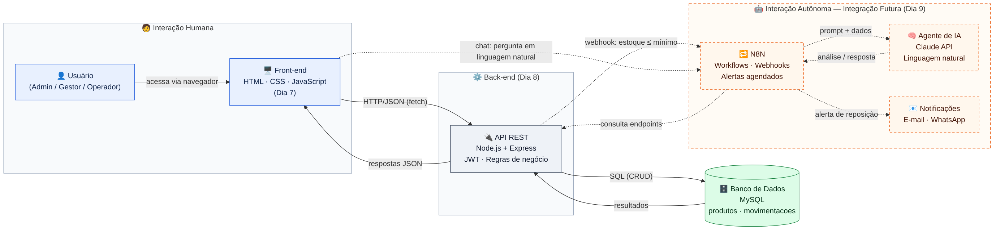

# 🏗️ Arquitetura da Solução — SmartStock

Arquitetura **em camadas** (cliente-servidor), com comunicação via **API REST/JSON**. O Front-end cuida da interface humana; o agente de IA e o N8N operam em paralelo, consumindo a mesma API para automações e consultas em linguagem natural.

## 1. Fluxograma



> Linhas **contínuas** = fluxo implementado nos Dias 7 e 8.
> Linhas **tracejadas** (laranja) = integração futura com IA e N8N (Dia 9).

## 2. Camadas e responsabilidades

| Camada | Tecnologia | Responsabilidade |
|---|---|---|
| **Usuário** | Navegador | Admin, gestor ou operador interagindo com o sistema |
| **Front-end** | HTML, CSS, JavaScript | Telas, validação de formulários, chamadas `fetch` à API, exibição do dashboard |
| **API (Back-end)** | Node.js + Express | Autenticação JWT, regras de negócio (RN01–RN05), CRUD, relatórios, disparo de webhooks |
| **Banco de Dados** | MySQL | Persistência de produtos e movimentações |
| **N8N** *(futuro)* | N8N | Orquestra automações: alerta de reposição, relatórios agendados, ponte com a IA |
| **Agente de IA** *(futuro)* | Claude API | Interpreta perguntas em linguagem natural, analisa dados de estoque e sugere reposições |

## 3. Fluxo principal (usuário)

1. **Usuário** acessa o sistema e faz login.
2. **Front-end** envia `POST /api/auth/login` → recebe token JWT.
3. Usuário registra uma saída → Front envia `POST /api/movimentacoes`.
4. **API** valida o saldo, grava movimentação + atualiza produto em transação no **Banco de Dados**.
5. API devolve JSON → Front atualiza a tela e o dashboard.

## 4. Onde entram a IA e o N8N

| Ponto de integração | Como funciona |
|---|---|
| **Alerta de reposição** | Após uma saída, se `quantidade <= estoque_minimo`, a API dispara um **webhook** para o N8N, que envia e-mail/WhatsApp ao gestor |
| **Relatório agendado** | Um *Cron* no N8N consulta `GET /api/relatorios/criticos` toda manhã e envia o resumo |
| **Assistente de estoque (chat)** | O Front envia a pergunta ao webhook do N8N → N8N chama a **Claude API** com os dados obtidos da API → resposta volta ao usuário |
| **Sugestão de compra** | A IA analisa o histórico de saídas e sugere quantidades de reposição |

## 5. Endpoints planejados da API

| Método | Rota | Descrição |
|---|---|---|
| POST | `/api/auth/login` | Autenticação |
| GET | `/api/produtos` | Listar/buscar produtos (`?busca=&categoria=`) |
| GET | `/api/produtos/:id` | Detalhar produto |
| POST | `/api/produtos` | Cadastrar produto |
| PUT | `/api/produtos/:id` | Atualizar produto |
| DELETE | `/api/produtos/:id` | Excluir produto |
| GET | `/api/movimentacoes` | Histórico (`?inicio=&fim=&tipo=&produto=`) |
| POST | `/api/movimentacoes` | Registrar entrada/saída |
| GET | `/api/dashboard` | Indicadores consolidados |
| GET | `/api/relatorios/estoque` | Posição atual do estoque |
| GET | `/api/relatorios/criticos` | Produtos abaixo do mínimo |
| POST | `/api/webhooks/n8n` | Receber retorno/ações vindas do N8N |

## 6. Estrutura de pastas prevista

```
smartstock/
├── frontend/      # Dia 7 – telas HTML/CSS/JS
├── backend/       # Dia 8 – API Node.js/Express
│   ├── src/routes  src/controllers  src/services  src/db
├── database/      # schema.sql
├── automacoes/    # Dia 9 – workflows N8N exportados (.json)
└── docs/          # documentação (Dia 6)
```
