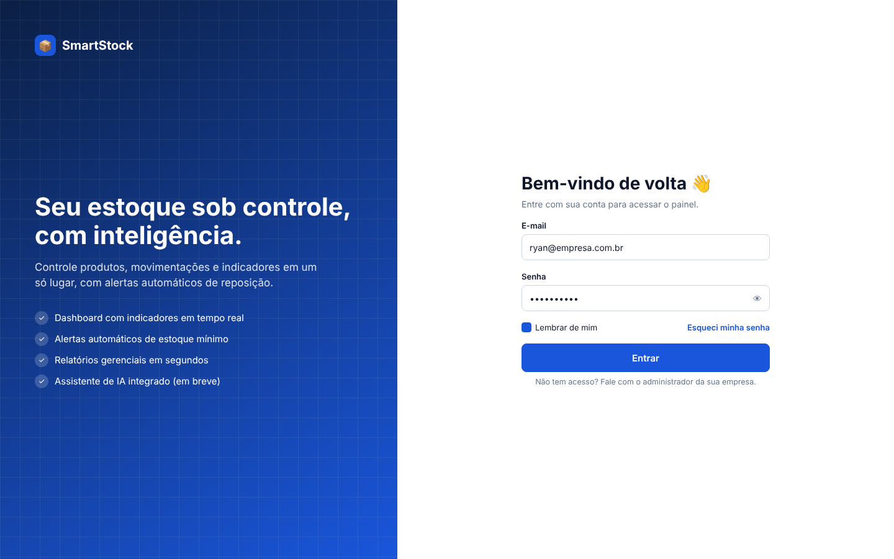
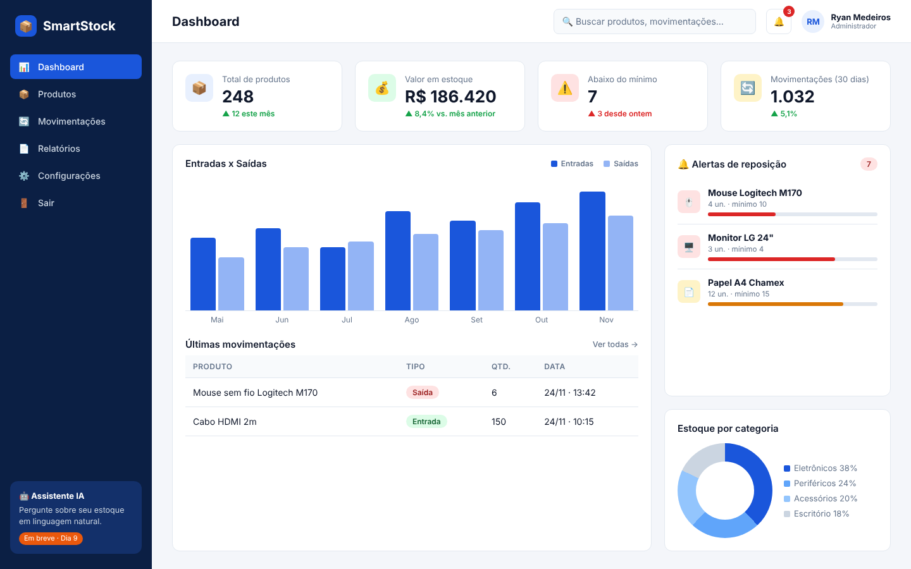
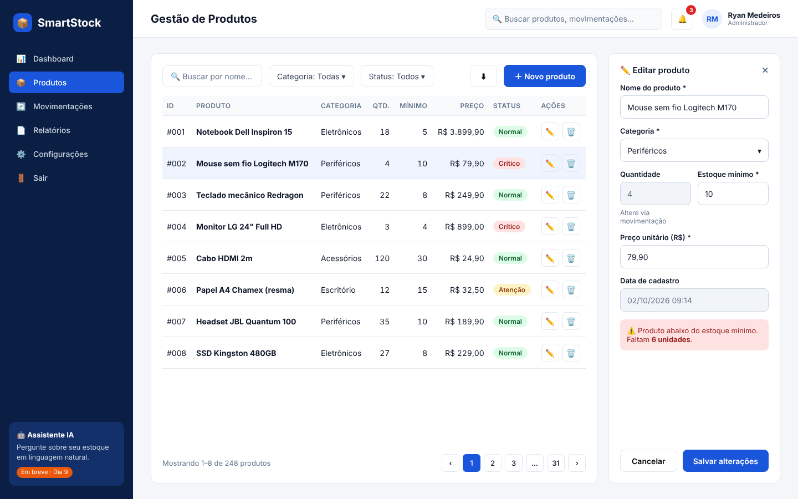
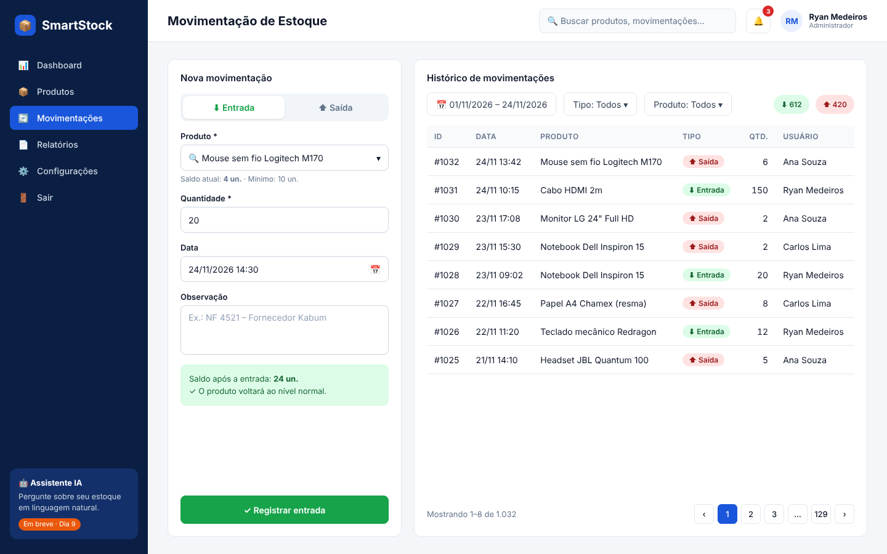
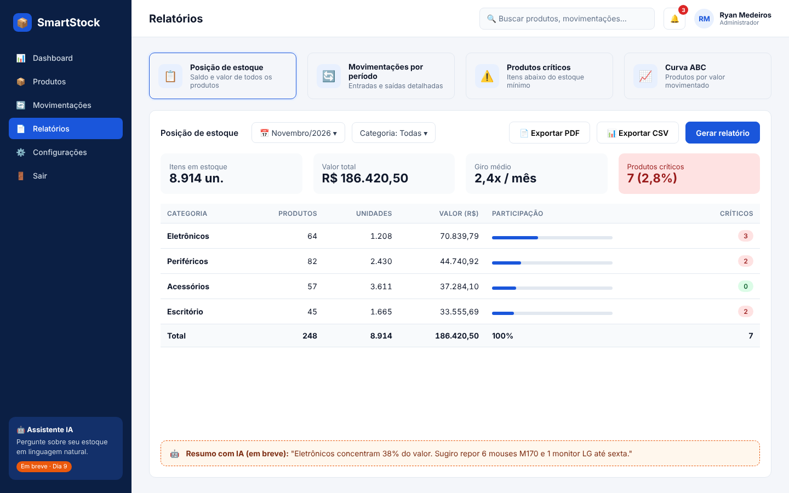
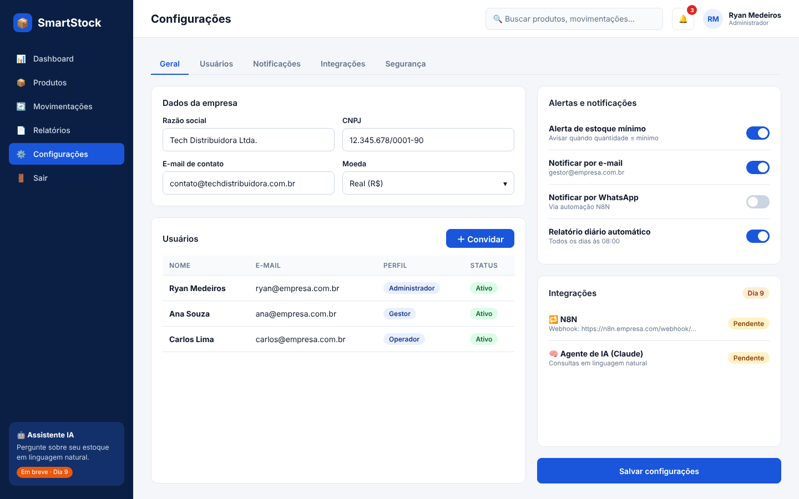

# 🎨 Protótipo (Figma) — SmartStock

🔗 **Figma:** https://www.figma.com/design/iBujYsVVPs2T4p35vuAzIg
▶️ **Modo protótipo:** abra o arquivo e clique em **Present** (▶). O fluxo começa no Login → botão **Entrar** leva ao Dashboard e o menu lateral navega entre as telas.

Versão navegável em HTML: [`prototipo/index.html`](../prototipo/index.html) (abra no navegador; navegação pelo menu lateral).

## Telas

| # | Tela | Objetivo | Requisitos atendidos |
|---|---|---|---|
| 1 | **Login** | Autenticação do usuário | RF01 |
| 2 | **Dashboard** | Visão geral: KPIs, entradas x saídas, alertas, estoque por categoria | RF09, RF10, RF11 |
| 3 | **Gestão de Produtos** | Listar, buscar, filtrar, cadastrar, editar e excluir produtos | RF02–RF05, RF10 |
| 4 | **Movimentação de Estoque** | Registrar entrada/saída e consultar histórico | RF06–RF08 |
| 5 | **Relatórios** | Relatórios gerenciais, exportação PDF/CSV, resumo com IA (futuro) | RF12, RF13, RF16 |
| 6 | **Configurações** | Dados da empresa, usuários, alertas e integrações (N8N/IA) | RF14, RF15 |

### 1. Login

### 2. Dashboard

### 3. Gestão de Produtos

### 4. Movimentação de Estoque

### 5. Relatórios

### 6. Configurações

## Guia de estilo

| Token | Valor | Uso |
|---|---|---|
| Primária | `#1A56DB` | Botões, item ativo do menu, links |
| Sidebar | `#0B1F44` | Menu lateral |
| Fundo | `#F4F6FA` | Fundo das telas |
| Texto | `#0F172A` / `#64748B` | Texto principal / secundário |
| Sucesso | `#16A34A` | Entrada, status Normal |
| Alerta | `#D97706` | Status Atenção |
| Erro | `#DC2626` | Saída, status Crítico, alertas |
| IA / Futuro | `#EA580C` | Elementos da integração do Dia 9 |
| Fonte | Inter (400/500/600/700) | Toda a interface |
| Grid | Desktop 1440 × 900 · sidebar 240px · espaçamento 8/12/16/20/32 | |

## Boas práticas de UX/UI aplicadas

- **Consistência:** mesma sidebar, cabeçalho e componentes (botões, badges, tabelas) em todas as telas.
- **Hierarquia visual:** KPIs em destaque no topo; ação principal sempre com botão primário azul.
- **Código de cores semântico:** verde = entrada/normal, vermelho = saída/crítico, amarelo = atenção.
- **Feedback imediato:** prévia do saldo antes de registrar uma movimentação; aviso quando o produto está abaixo do mínimo.
- **Prevenção de erros:** campo *Quantidade* bloqueado na edição do produto (só muda via movimentação — RN02); campos obrigatórios marcados com `*`.
- **Status visível:** badge de notificações no sino, contador de alertas, paginação com total de registros.
- **Acessibilidade:** contraste adequado (texto escuro sobre fundo claro), rótulos em todos os campos, ícone + texto nos itens de menu.
- **Preparação para IA:** espaços reservados (card "Assistente IA", "Resumo com IA", integrações) já pensados para o Dia 9.
