# 🖥️ SmartStock – Front-end (Atividade 7)

Interface web do SmartStock em **React + Vite**, construída a partir do protótipo da Atividade 6 ([Figma](https://www.figma.com/design/iBujYsVVPs2T4p35vuAzIg)).

🌐 **Demo online:** https://ryanmedeiros01.github.io/smartstock/
🎬 **Vídeo da navegação:** [docs/demo-navegacao.mp4](docs/demo-navegacao.mp4)

> Login de demonstração: qualquer e-mail válido e senha com 4 ou mais caracteres.

## ▶️ Como rodar

Pré-requisito: [Node.js 18+](https://nodejs.org)

```bash
cd frontend
npm install
npm run dev      # http://localhost:5173
npm run build    # gera a versão de produção em /dist
```

## ✅ Telas e funcionalidades

| Tela | O que faz |
|---|---|
| **Login** | E-mail e senha com validação, mostrar/ocultar senha, carregamento e rota protegida |
| **Dashboard** | Total de produtos, quantidade em estoque, produtos com estoque baixo, movimentações recentes, gráfico de barras (entradas x saídas) e gráfico de rosca (valor por categoria) |
| **Gestão de Produtos** | Listagem com busca, filtros por categoria e status, paginação, **cadastro**, **edição** e **exclusão** (com confirmação), exportação CSV |
| **Movimentação de Estoque** | **Entrada** e **saída** com prévia do saldo, bloqueio de saldo negativo, alerta de estoque mínimo e **histórico** com filtros |
| **Relatórios** | **Produtos cadastrados**, **produtos com estoque baixo** (com sugestão de compra) e **resumo das movimentações** com gráfico; exportação CSV e PDF (impressão) |
| **Configurações** | Dados da empresa, usuários, notificações, integrações (N8N/IA) e tema |

### Regras de negócio da Atividade 6 já aplicadas
- **RN01:** saída maior que o saldo é bloqueada.
- **RN02:** a quantidade não é editável no produto; ela só muda por movimentação.
- **RN03:** status *Crítico* quando `quantidade <= estoque_minimo`.
- **RN04:** produto com movimentações não pode ser excluído.
- **RN05:** a quantidade da movimentação deve ser maior que zero.

## ⭐ Diferenciais

- 📊 **Dashboard com gráficos** interativos (Recharts)
- 🌙 **Tema claro/escuro** salvo no navegador
- 🧩 **Bibliotecas de UI:** Recharts (gráficos) e Lucide (ícones)
- ✨ **Micro-interações:** toasts de feedback, animações de página, skeleton loading, hover em tabelas
- 📱 **100% responsivo:** menu lateral vira gaveta no celular
- 🚀 **Deploy automático** no GitHub Pages via GitHub Actions

## 🗂️ Organização do código

```
frontend/
├── src/
│   ├── components/
│   │   ├── layout/        # AppLayout, Sidebar, Topbar
│   │   ├── ui/            # Button, Card, KpiCard, Badge, Field, Modal, ConfirmDialog, Toast, Switch, Skeleton, EmptyState
│   │   └── ProdutoForm.jsx
│   ├── context/           # AuthContext, StockContext (estado global), ThemeContext
│   ├── data/mock.js       # dados simulados (mesmo modelo do banco da Atividade 6)
│   ├── pages/             # Login, Dashboard, Produtos, Movimentacoes, Relatorios, Configuracoes
│   ├── services/api.js    # camada de API (mock hoje, REST na Atividade 8)
│   ├── styles/global.css  # design tokens + tema escuro + responsividade
│   └── utils/format.js    # moeda, datas, status do estoque, exportação CSV
└── docs/                  # capturas de tela e vídeo
```

**Conceitos de React usados:** componentes, props, `useState`, `useEffect`, `useMemo`, `useCallback`, Context API, React Router (rotas protegidas) e formulários controlados.

## 🔌 Pronto para a Atividade 8

Todas as telas consomem dados por meio de `src/services/api.js`. Para ligar na API real:

1. Mudar `USE_MOCK` para `false`.
2. Criar `frontend/.env` com `VITE_API_URL=http://localhost:3000/api`.

Os endpoints esperados (`/auth/login`, `/produtos`, `/movimentacoes`) são os documentados em [docs/03-arquitetura.md](../docs/03-arquitetura.md).

## 📸 Capturas de tela

| Login | Dashboard |
|---|---|
| 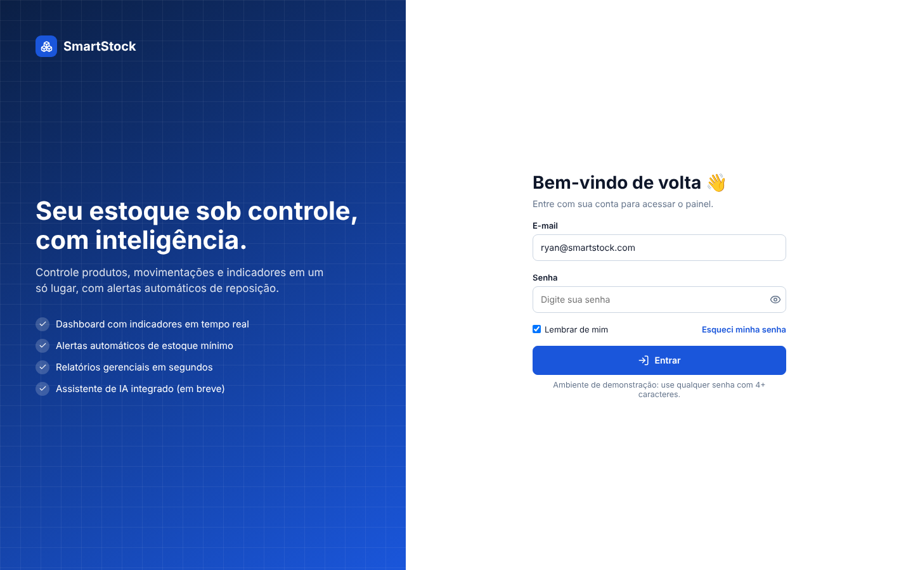 | 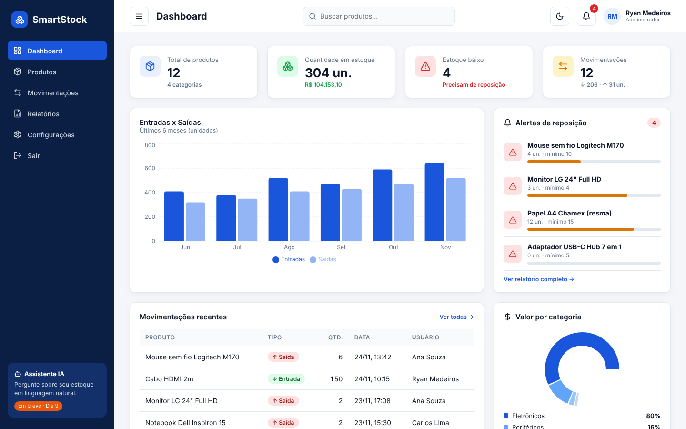 |
| **Produtos** | **Cadastro de produto** |
| 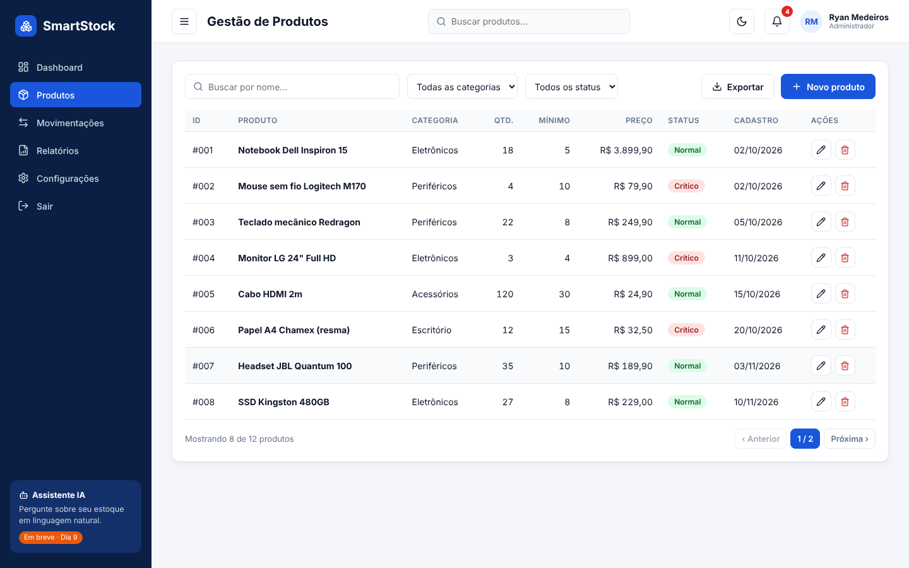 | 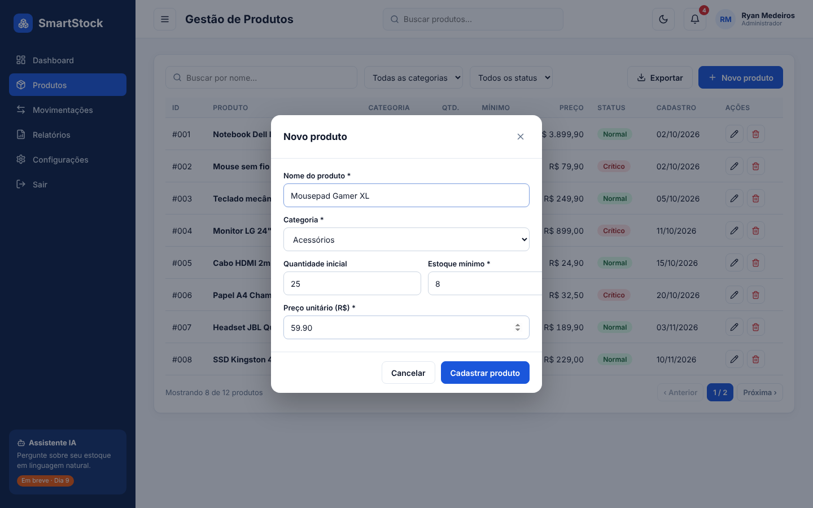 |
| **Edição de produto** | **Movimentações** |
| 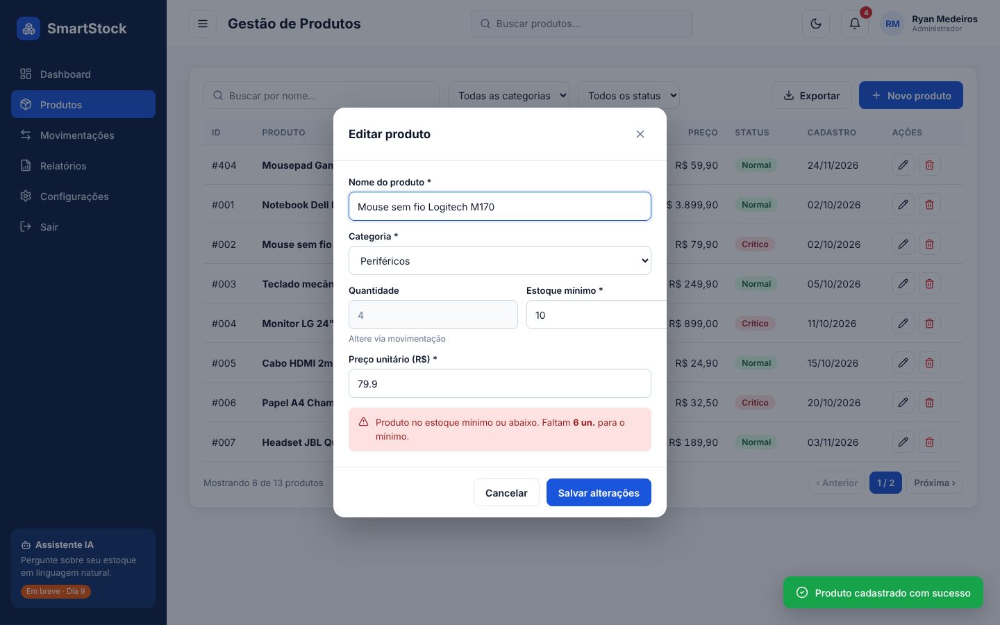 | 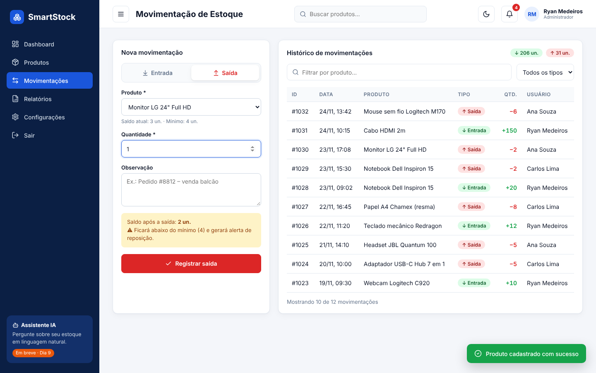 |
| **Relatório – Produtos** | **Relatório – Estoque baixo** |
| 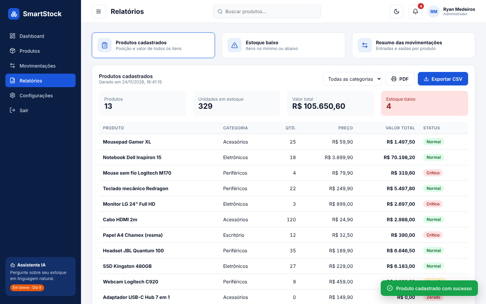 | 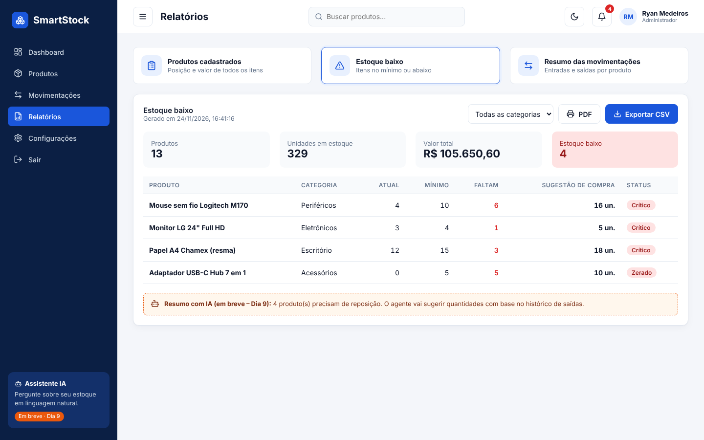 |
| **Relatório – Movimentações** | **Configurações** |
| 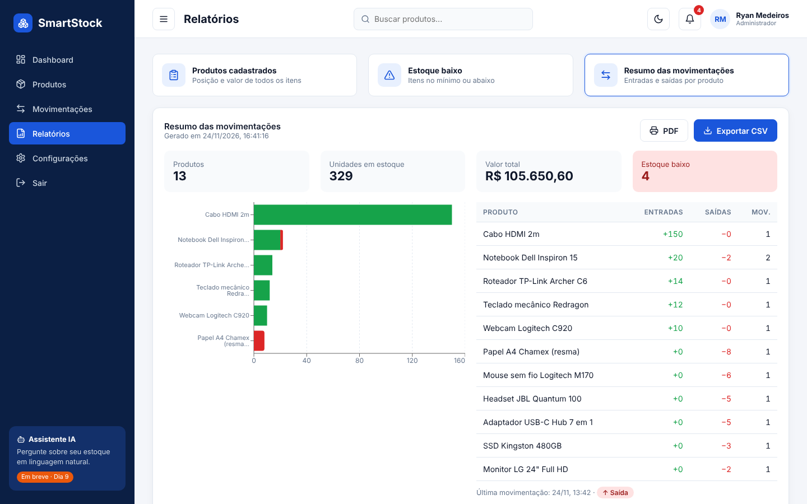 | 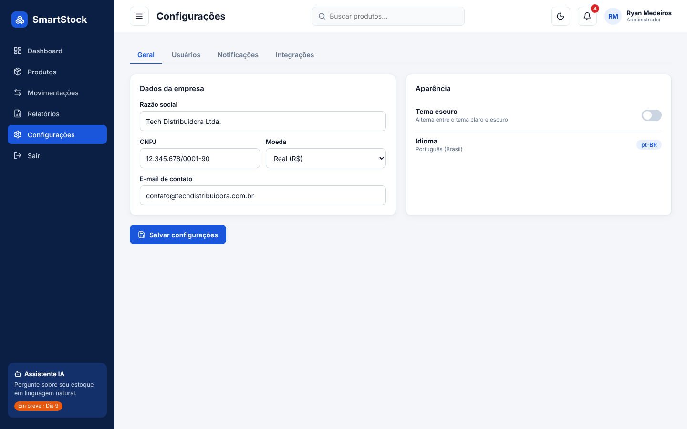 |
| **Tema escuro** | **Celular** |
| 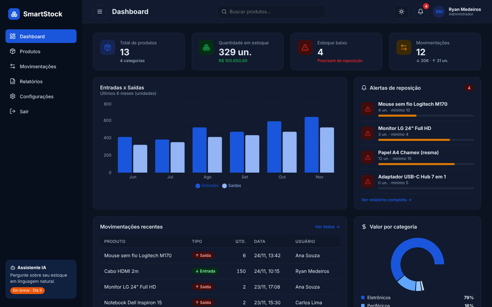 | 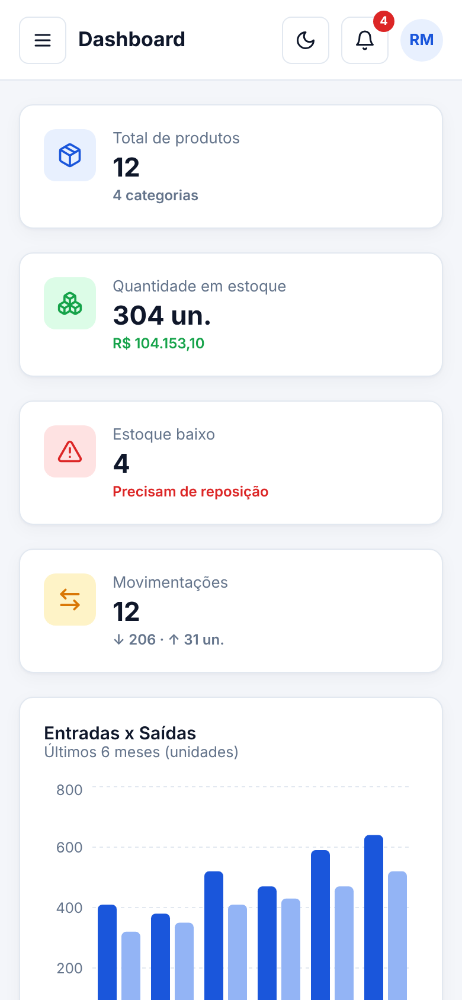 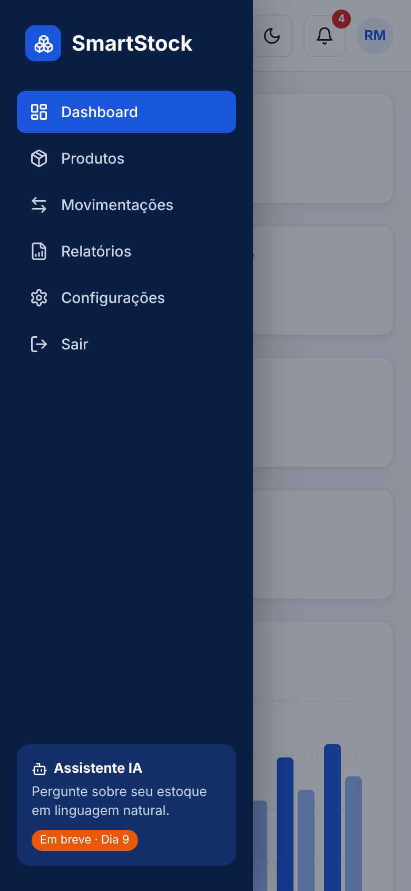 |
